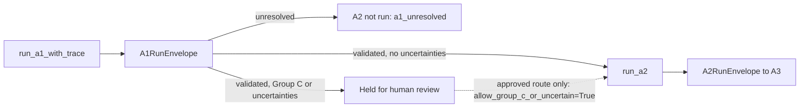
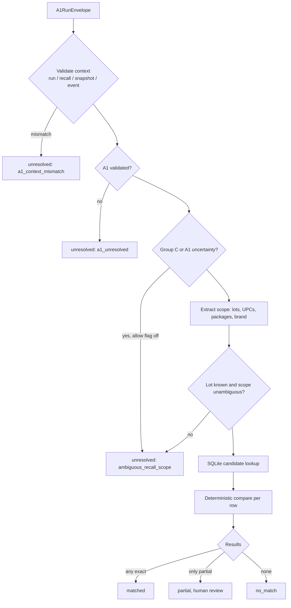

# RecallReady A2: Inventory Investigation Agent

A2 takes a **validated A1 recall interpretation**, checks it against **authoritative retailer inventory (SQLite)**, and returns typed **potentially-affected-stock findings** for A3.

A2 is fully **deterministic and offline**: no LLM calls, no Qdrant queries, no database writes. It never recommends removal, quarantine or any customer action; that belongs to A3.

Requirements source: `A2_AGENT_IMPLEMENTATION_REQUIREMENTS.md` (repo root, one level up).

---

## 1. Trust boundary

1. A1 identifies the recall scope (product, lot/batch, UPC, package, uncertainties).
2. A2 compares that scope to retailer SQLite rows. SQLite is the only authority for brand, product, package, lot, quantity and store.
3. A2 reports findings only. A1 uncertainty stays visible and is **never** turned into an exact match.
4. An unknown or blank attribute is **not** evidence of a match or of no match. It yields `partial` or `unresolved`, never a broadened search.

---

## 1a. Quick view: what A1 does and how it hands off to A2

**A1 (FDA Recall Interpretation Agent)** reads one FDA food recall record and turns it into typed, evidence-cited facts. It does not look at inventory and does not decide what stock is affected.

1. **Select:** the caller picks `recall_number` + `snapshot_id` (optional `event_id`). Scope is the 18 development recalls (Groups A, B, C).
2. **Retrieve:** Qdrant returns the 4 source passages (product description, code info, reason, distribution). Every hit is re-resolved against the exact FDA SQLite store, so Qdrant is only candidate discovery.
3. **Interpret:** one bounded OpenAI call (`gpt-6-luna`) proposes identifiers (lot, batch, UPC, SKU, dates) and uncertainties. Facts, IDs and original text are copied from the local source, not written by the model.
4. **Validate:** strict Pydantic plus source checks. Anything unsupported makes the run `unresolved`; there is no guessed output.
5. **Wrap:** `run_a1_with_trace(...)` returns an `A1RunEnvelope`.

| A1 envelope field | Meaning for A2 |
|---|---|
| `run_id` | Execution identity; A2 checks it matches |
| `status` | `validated` or `unresolved`. A2 only works on `validated` |
| `result` | `A1Result` (`0.1-proposed`, Groups A/B) or `GroupCResult` (`0.2-group-c-provisional`: `base` + explicit `relations`) |
| `error` | Set only when `unresolved` |
| `trace` | Recall, snapshot and canonical `event_id`, plus usage/accounting; A2 uses it to verify identity |

Inside `result`, A2 reads `facts.product_name`, `facts.identifiers` (kind + literal value), `facts.uncertainties` and `facts.evidence_ids`. Group C adds `relations` (lot/code to date pairs).

**Handoff rules (A1 to A2):**



- A2 receives the **whole envelope**, not a copy of its facts. The envelope stays in `CaseState.a1`.
- A2 re-checks `run_id`, `recall_number`, `snapshot_id` and `event_id` against the envelope and any caller values, and rejects mismatches.
- In the A1-only coordinator, a validated run with no uncertainties ends as `a1_completed` and is the normal input to A2. Group C and any run with uncertainties end as `human_review` and are not passed on by default.
- A1 uncertainty always survives into A2: it either blocks the run (`ambiguous_recall_scope`) or appears on the findings (`a1_uncertainties`, `requires_human_review`).

---

## 2. Folder layout

New A2 files (everything else in this folder is the unchanged A1 code that A2 imports):

| File | Role |
|---|---|
| `a2_agent.py` | `run_a2(...)`, A1-to-scope extraction, and the typed output models `InventoryFinding`, `A2RunEnvelope`, `A2Error` |
| `inventory_match.py` | Pure deterministic comparison: `compare_recall_to_inventory(scope, row)` |
| `inventory_store.py` | Read-only SQLite store (`InventoryStore`), candidate lookup, product-name equivalence table |
| `inventory_loader.py` | Builds the synthetic inventory SQLite DB from `02_retailer_inventory_SYNTHETIC.json` |
| `tests/test_inventory_loader.py`, `test_inventory_store.py`, `test_inventory_match.py`, `test_a2_agent.py`, `test_a2_review_fixes.py` | 28 offline tests |

A1 modules A2 depends on: `a1_run.py` (`A1RunEnvelope`), `a1_trace.py`, `models.py` (`A1Result`, `StrictModel`), `group_c_contract.py` (`GroupCResult`). The inventory modules themselves import only `models.py`.

---

## 3. Data flow



### Scope extraction (`_extract_a1_scope`)

- **`A1Result` (`0.1-proposed`)**: lots come from identifiers of kind `lot` **and `batch`**; UPC/SKU from their kinds; package sizes parsed literally from `facts.product_name`; brand only if the text literally says `"<Name> brand"` (never inferred from `recalling_firm`).
- **`GroupCResult` (`0.2-group-c-provisional`)**: uses `result.base` for facts, but lots/codes come **only from explicit relations** (`lot_date`, `code_date`, `state_code_date`, `package_code_date`). The flat identifier list is not used to widen them; `date_range` is skipped. If there are several package sizes and several lots with no `package_code_date` relation, scope is `ambiguous_recall_scope`.

### Run order inside `run_a2`

1. Context check, then A1 status check
2. Store available (duck-typed: needs `snapshot_id` and `find_inventory_candidates`) and its `snapshot_id` equals A1's
3. Group C or any A1 uncertainty stops here unless `allow_group_c_or_uncertain=True`
4. Package/lot ambiguity, no identifiers and no package info, or no known lot all return `ambiguous_recall_scope`
5. Candidate lookup, then per-row compare, then status

---

## 4. Matching rules

`compare_recall_to_inventory` returns one status per attribute: `matched`, `mismatched` or `unknown`.

| Attribute | Rule |
|---|---|
| Lot | Exact string compare; leading zeros and case preserved (`060723` never matches `60723`) |
| UPC | Spaces/hyphens removed, digits only, used for UPC compare only |
| Package size | Numeric value + unit (`oz, lb, g, kg, gallon`); `7.05oz` equals `7.05 oz` |
| Product name | Exact or bounded equivalence table (`APPROVED_PRODUCT_NAME_EQUIVALENCES` in `inventory_store.py`); no fuzzy/LLM matching |
| Brand | Compared only when both sides have a concrete brand; blank inventory brand is `unknown` |

Match level per row:

| Condition | Level |
|---|---|
| Any `mismatched`, or product not matched | `no_match` |
| Lot and product matched, no secondary attribute unknown, no A1 uncertainty | `exact` |
| Lot matched but a secondary attribute is unknown or A1 has uncertainty | `partial` |
| Lot unknown in inventory, recall has a lot | `no_match`, or `partial` if the UPC matched |

`partial` rows carry reason codes explaining why, for example `secondary_unknown:package_size`, `secondary_unknown:upc`, `secondary_unknown:brand`. Matches also record their source, for example `lot_source:batch_identifier:2-402` or `lot_source:relation:code_date:TFIC209|8/9/2026`.

`*-B` rows in the fixture are ordinary rows. They are excluded because product, lot or package don't match. `synthetic_generation_note` and the `-A`/`-B` suffix are never used for matching.

---

## 5. Output contract

`run_a2(...)` returns an `A2RunEnvelope`:

| Field | Meaning |
|---|---|
| `case_id`, `run_id`, `recall_number`, `snapshot_id`, `event_id` | Identity (`event_id` can be `None` only if A1 never resolved one) |
| `status` | `matched`, `partial`, `no_match` or `unresolved` |
| `findings` | List of `InventoryFinding`, one per inventory row, never merged |
| `error` | `A2Error` only when `unresolved` |
| `requires_human_review` | `True` for `partial` and `unresolved` |

Status invariants (enforced by validators): `matched` needs at least one exact finding; `partial` has no exact finding and requires review; `no_match` has an empty list (a successful zero-result search, not an error); `unresolved` has an error and no findings.

`InventoryFinding` keeps original SQLite strings exactly (`lot_code`, `upc`, `package_size`, `product_label`, `brand`), plus `simulated_quantity`, `quantity_unit`, `store_id`, `retailer_id`, `inventory_reference_date`, per-attribute match statuses, `reason_codes`, A1 evidence IDs/uncertainties and `requires_human_review`. All models are strict (`extra="forbid"`), so there are no action or disposition fields.

Error codes: `a1_unresolved`, `a1_context_mismatch`, `inventory_store_unavailable`, `inventory_schema_invalid`, `inventory_match_failed`, `ambiguous_recall_scope`. Messages are non-sensitive; no SQL or exception text is exposed. A database failure is always `unresolved`, never `no_match`.

---

## 6. Inventory database

`inventory_loader.py` loads `02_retailer_inventory_SYNTHETIC.json` into SQLite with a `manifest` table and an `inventory` table (14 columns exactly as in the JSON). It checks 48 sets, 96 rows, one `*-A` and one `*-B` per set, and `source_type = SYNTHETIC`. It refuses to overwrite an existing file.

`InventoryStore` opens the DB with `?mode=ro` plus `PRAGMA query_only=ON` and validates the column set and manifest. Candidate lookup filters in SQLite, in priority order: UPC, then exact lot, then product label (or package size when no product name), then brand only if nothing else matched. `resolve_candidate_ids(...)` and the `candidate_item_ids` option re-check vector-index IDs against SQLite and drop any ID not present.

---

## 7. Usage

```powershell
# Build the synthetic inventory DB (run from this folder; refuses to overwrite)
python inventory_loader.py runtime\retailer_inventory.sqlite --json-path ..\02_retailer_inventory_SYNTHETIC.json
```

```python
from pathlib import Path
from a2_agent import run_a2
from inventory_store import InventoryStore

with InventoryStore(Path("runtime/retailer_inventory.sqlite")) as store:
    a2 = run_a2(store, a1_envelope, case_id="case-001")   # a1_envelope from run_a1_with_trace
    print(a2.status, [(f.item_id, f.match_status, f.simulated_quantity) for f in a2.findings])
```

`run_a2` also accepts `run_id`, `recall_number`, `snapshot_id`, `event_id` (each checked against the A1 envelope), `candidate_item_ids`, and `allow_group_c_or_uncertain` (default `False`). With `True`, uncertain or Group C scopes can produce `partial` findings that keep the A1 uncertainty and require review; they are never `exact`.

Observed on the reviewed Group A examples: `H-0011-2027` and `F-1542-2023` give `matched` (`INV-001-A`, `INV-003-A`). The four recalls with A1 uncertainties give `unresolved` / `ambiguous_recall_scope` by default. With the flag on, `H-0579-2025` and `F-0324-2023` give `partial`.

---

## 8. Tests

```powershell
$env:PYTHONPATH = (Get-Location).Path
python -m unittest discover -s tests -p "test_*.py" -v
```

Expected: `Ran 28 tests ... OK`. Tests need no API keys or network and create temporary databases from the synthetic JSON. They cover most of the acceptance list in requirements section 10; a few edge cases (for example duplicate `*-A` rows and the unknown-lot path) have no dedicated test yet.

---

## 9. Open items before full integration

- **M1 approval** of the `InventoryFinding` / `A2RunEnvelope` fields and statuses (currently proposed here, not yet shared contract) and of the inventory table layout.
- **M1 approval** of the product-name equivalence table. It is bounded but built from the 48 fixture labels.
- **M1 confirmation** that A1 `batch` values may be compared to inventory `lot_code`.
- **Coordinator wiring** is not done here. See `agent2_to_coordinator_patching.md` (repo root) for the `case_state.py` / `coordinator.py` changes. A1 needs no changes (`agent2_to_agetn1_patching.md`).
- **Fixture limits:** inventory has no date or package-type column, so Group C dates are recorded as provenance but not compared. Rows with blank package or brand cannot reach `exact` when the recall specifies them.
