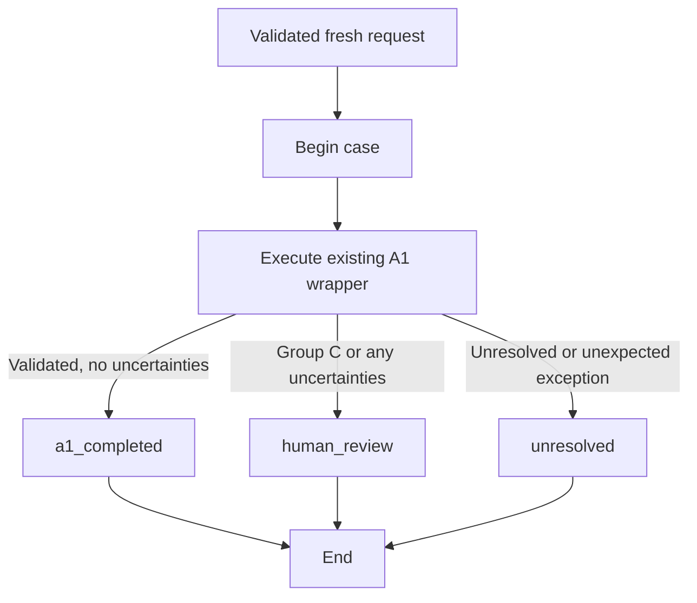

# A1-only coordinator and case state

## Implemented scope

Member 1 authorized development of the shared state foundation and A1-only
coordinator. `case_state.py` defines the typed request, events and state;
`coordinator.py` compiles and executes the real LangGraph graph. It calls the
existing `run_a1_with_trace` once and preserves its complete envelope.

This is the A1 slice of the coordinator. It does not implement A2–A4, inventory
inputs, critic correction, review approval/resumption, hosted storage or a UI.
It does not claim that a completed A1 interpretation completes an investigation.

## Flow and routing



Graph nodes use StateGraph state updates and conditional edges, following the
[official graph API](https://reference.langchain.com/python/langgraph/graph/state/StateGraph).
Installed direct additions are `langgraph==1.2.24` and `langsmith==0.15.1`,
recorded in requirements. LangSmith is used only to explicitly disable remote
tracing with its context manager, including when ambient settings enable it.
No remote graph service is needed.

The graph has no retry policy or loops. A1's existing bounded structural repair
still applies within its own request. Group C always routes to review, including
the unknown-code case with no relations. Group A/B uncertainties also route to
review; a caller-supplied historical lot approval does not erase uncertainties.
`revision_count` is fixed at zero until a critic workflow is separately built.

## State contract

| Field | Meaning |
| --- | --- |
| `case_id` | Caller-selected case identifier |
| `run_id` | Unique caller-selected execution identifier |
| `recall_number`, `snapshot_id` | Exact selected FDA scope |
| `event_id` | Optional caller constraint; canonical event remains in A1 output/trace |
| `status` | `pending`, `running`, `a1_completed`, `human_review`, or `unresolved` |
| `a1` | Complete A1 run envelope or null after an unexpected failure |
| `events` | Ordered, timestamped event names with no prompts or source passages |
| `errors` | Typed run errors; empty for successful/review routes |
| `review_reason` | Explicit reason on the review route only |
| `revision_count` | Zero in this A1-only implementation |

Facts, evidence, model usage and Group C relations remain inside `a1`; the
state does not create duplicate independently editable copies. It checks the
envelope's selected recall/snapshot/run against the case and rejects terminal
states that remove required review or contain contradictory success/errors.
This is a typed A1-specific CaseState, not a final all-agent schema. Fields
for stock findings, suggestions and critic verdicts await their real contracts.

`A1Coordinator.run` accepts a fresh `CaseRequest` or dictionary. Extra fields
such as caller-authored prior results, status, revision count or inventory are
rejected before execution. Reusing a coordinator creates a fresh graph state;
it does not resume a prior case. Callers must use unique run IDs. Durable
deduplication and checkpoints are not implemented.

## Running and resource ownership

Install dependencies and run offline verification from `code_workspace`:

```bash
.venv/bin/python -m pip install -r requirements.txt
.venv/bin/python -m pytest tests/test_coordinator.py -q
.venv/bin/python -m pytest -q
.venv/bin/python -m pip check
```

Offline tests need no API keys. For an actual request, reuse the existing
store, retriever, OpenAI client and budget setup in the
[A1 handoff](A1_HANDOFF_2026-11-20.md), then call:

```python
from uuid import uuid4
from case_state import CaseRequest
from coordinator import A1Coordinator

coordinator = A1Coordinator(store, retriever, client, budget)
state = coordinator.run(CaseRequest(
    case_id=str(uuid4()), run_id=str(uuid4()),
    recall_number="H-1388-2026", snapshot_id=store.snapshot_id,
))
print(state.model_dump_json(indent=2))
```

With live clients this invokes Qdrant and paid OpenAI interpretation. This
library flow was exercised in the live pilot below. Executing the example
again creates another potentially chargeable request.
The caller owns/ closes the clients and store; do not share a SQLite source
connection across threads. There is no latest-coordinator CLI yet. Use the
library interface or offline tests; the older interpreter CLI bypasses this graph.

State contains original evidence in its A1 result. The graph disables remote
tracing; the caller owns private JSON retention. No checkpointer, automatic
file persistence or human approval action is configured. JSON round trips
are supported with `CaseState.model_validate_json(state.model_dump_json())`.

## Failure behavior

Expected A1 failures keep their unresolved envelope, typed error, trace and
budget semantics. The graph records `a1_unresolved`, routes to `stop`, and ends.
It does not continue to a downstream agent or regenerate the model response.

An unexpected exception is handled at the coordinator application boundary:
the case becomes unresolved with `coordinator_internal_failure`, no invented
A1 result/trace, and unknown request outcome. The safe event and error exclude
the exception's potentially sensitive text. Accounting may already exist;
inspect the run-linked ledger before any manual rerun. This handler does not
catch process termination/keyboard interrupts or guarantee crash recovery.

Human-review routing is a stop for human inspection, not a new approval.
`a1_completed` means validated A1 work without reported uncertainties. It
does not mean affected stock, safe stock, critic acceptance or final case closure.

## Actual verification and next gates

32 coordinator tests passed within the full suite: **912 passed in 5.79
seconds**. `pip check` reported no broken requirements. Tests use the real
compiled graph, source store, retrieval validation, SDK serialization and
final validators. Network responses alone are simulated.

Coverage includes all 18 recalls, complete Group C relationships, uncertainty
routing, invalid context, missing retrieval, provider/semantic/accounting
failures, unexpected exceptions, strict fresh inputs, JSON state consistency,
caller resource ownership, disabled tracing and repeated-run isolation.

The focused coordinator tests were rerun before the live pilot: 32 passed in
1.70 seconds. Dependency checks found no broken requirements. No production
code changes were required after review, so the full suite was not repeated
for this pilot; 912 is the preceding full-suite result.

## First live coordinator pilot

The actual compiled graph ran `H-1388-2026` through Qdrant, SQLite, OpenAI and
final validation on 20 November 2026. Its case events were
`started → a1_validated → human_review`. The A1 envelope was validated; the
case correctly stopped for review with no errors and zero revisions. This
does not record a new human approval.

| Measure | Actual result |
| --- | --- |
| Recall / event | `H-1388-2026` / `99841` |
| First / last case event UTC | 2026-11-20T06:39:39.303129+00:00 / 2026-11-20T06:39:48.552085+00:00 |
| Case event interval | 9.248956 seconds |
| A1 trace duration / retrieval duration | 9.246351 / 0.631284 seconds |
| Source passages retrieved and verified | 4/4 |
| Model / output cap / SDK retries | `gpt-6-luna` / 4,000 tokens / 0 |
| Model requests / repairs | 1 / 0 |
| Reported input / output / included reasoning tokens | 1178 / 399 / 99 |
| Ledger call | 30, directly associated with the run ID |
| Estimated cost | $0.000318 at the existing historical ledger rates |

The two preserved lot/expiry pairs are `00000ZRAA1` / `08/15/2026` and
`00000ZUAD2` / `08/18/2026`. Their exact source spans and offsets remain in
the Group C result. Review uncertainty remains present.

The private local artifact is
`runtime/coordinator_live_20261120T063948552654Z.json`, with permissions `0600`.
It contains the complete case state, A1 envelope, events and usage trace.
A separate read-only check parsed it as `CaseState`, validated its Group C
result against the starter ZIP directly, checked the complete four-passage
retrieved/cited set and point IDs, and matched usage/response identity against
the run-linked ledger entry. All checks passed.

This pilot used the existing model, schema, collection and $1 local accounting
cap, with no graph retry or Qdrant data write. The source ZIP, baseline commit
and GitHub recovery tag remain unchanged. The artifact is excluded from Git.

These timings describe one execution, not average latency or a performance
guarantee. Costs use historical local rates, not verified provider billing;
OpenAI usage above excludes Qdrant inference usage. The A1 timer covers the
wrapped service, while the case interval spans the first and last graph
events, not external application setup or artifact serialization.

## Remaining integration work

The live review route is verified for one Group C development case. Success
and unresolved routes have offline coverage, not new live pilots. Development
continues on `feature/a1-coordinator`; the pushed
`baseline/agent1-working` and `a1-pre-coordinator-2026-11-20` recovery tag retain
the pre-coordinator A1 snapshot.

The pre-publication full suite passed 912 tests in 5.99 seconds. The next gates
are pull-request review and agreement on real A2–A4 state mappings and tests.
The critic's at-most-one targeted correction loop,
human approval/resumption, persistence, independent accuracy evaluation and
deployment remain future work.
