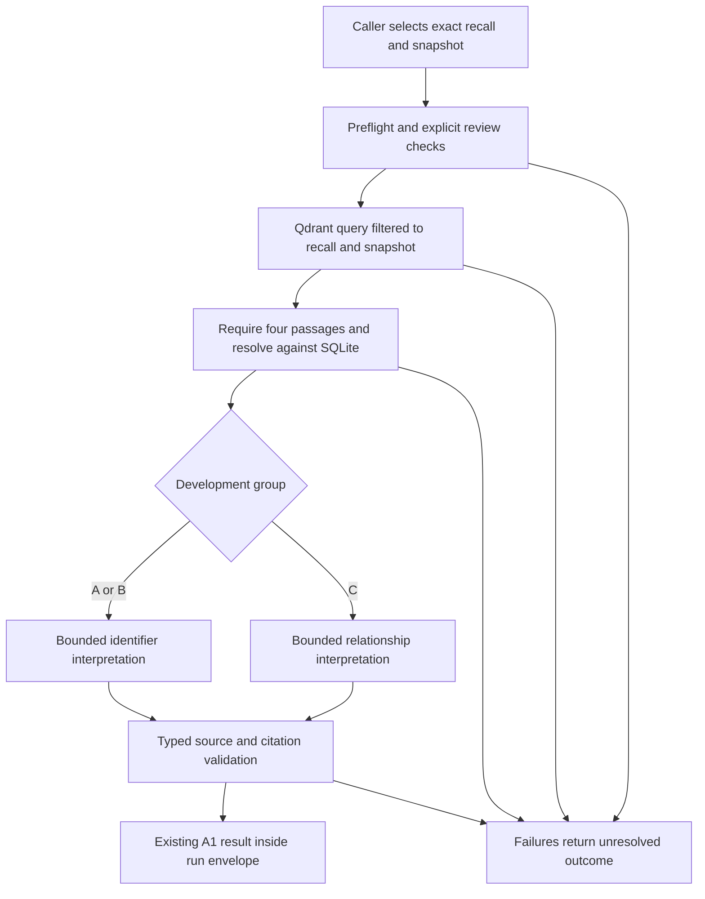

# RecallReady Agent 1 — development record

**As of:** 20 November 2026. This record explains the implementation for
teammates and future report authors. It preserves the distinction between
source validation, simulated-network tests, live development pilots and
independent evaluation. Operational instructions are in the
[technical handoff](A1_HANDOFF_2026-11-20.md).

## 1. Problem and implemented scope

FDA recall fields contain inconsistent lot, batch, UPC and date descriptions.
A flat list of tokens can lose a lot/date association; a plausible generated
identifier can also be unsupported by source text. A1 structures selected
historical recall evidence while preserving exact literals, provenance and
uncertainty for downstream investigation.

Implemented scope is 18 selected FDA food development recalls: six basic
(A), six intermediate (B), six relationship challenges (C). There are 18
distinct events and four passages per recall: product description, code
information, recall reason and distribution pattern. No recall is selected
by similarity. No inventory decision, stock quantity, safety conclusion or
disposal action is produced by A1.

The immutable starter ZIP is read directly. Derived CSV conveniences and
embedding text do not replace original source fields. The larger 40 MB data
file is not required by the runtime subset, and held-out labels remain outside
this development work.

## 2. Architecture and runtime flow



Qdrant ranks passages within a selected recall; SQLite supplies exact source
text. Because the current output contract requires all four source fields,
the service requires complete retrieval before model interpretation. This
is a bounded evidence workflow, not a demonstrated open-ended recall search.
The fixed query is not currently an externally editable request parameter.

The OpenAI model receives four canonical passage objects as untrusted data.
Firm/classification metadata comes from the exact record locally. Prompt
instructions prohibit obeying evidence as instructions, outside knowledge,
inventory decisions and unsupported literal/relationship invention.

## 3. Module map

| Module | Responsibility |
| --- | --- |
| `source.py` | Direct-ZIP lookup, checksums, selected records and exact passage resolver |
| `citations.py` | Citation context and exact literal support |
| `models.py` | Strict `0.1-proposed` A1 facts/source-field models |
| `validation.py` | Source/policy validation, identifier labels, unknown/ambiguity handling |
| `reviews.py` | Explicit caller-supplied, source-bound lot approvals |
| `interpreter.py` | Group A/B Responses adapter, bounded repair, accounting and legacy paid CLI |
| `group_c_contract.py` | Provisional Group C envelope and exact relationship checks |
| `group_c_interpreter.py` | Group C proposals, literal parts, local span offsets and validation |
| `fda_store.py` | Build/read authoritative FDA-only SQLite records/passages |
| `embedding_inputs.py` | Verify all 72 staging inputs against archive and exact store |
| `qdrant_a1.py` | HTTPS Cloud Inference ingest/query boundary and validated hits |
| `a1_service.py` | Complete-retrieval gate and routing to the two interpreters |
| `a1_trace.py` | Context-local request, response, evidence and accounting metadata |
| `a1_run.py` | Coordinator-facing result/error/trace envelope |
| `tests/` | Source, policy, adapter, retrieval, storage and wrapper regressions |

## 4. Development stages and corrections

1. **Exact source/citations.** Added lookups for the basic group, rejection of
   invented IDs and wrong recall/event/snapshot references, original-field
   checks and literal preservation. Expanded the same protections to B/C.
2. **Typed interpretation.** Added strict structured output and local assembly
   of canonical metadata. Invalid output permits at most one structural
   regeneration; semantic/source failures stop rather than trigger repair.
3. **Ambiguity policy and human review.** Preserved combined phrases when lot,
   date or BC boundaries are unsupported. Added explicit caller-bound review
   application while retaining the original model observations.
4. **Intermediate and challenge cases.** Added batch/lot/date/UPC cases and
   exact relations for Group C, keeping an approved separate provisional
   envelope around the unchanged basic A1 schema.
5. **Omission corrections.** A Group C relation-kind rule required correction.
   For `F-0536-2021`, an initial output omitted Item # and UPC; the validator
   was strengthened and a controlled retry included both reviewed literals.
   Historical rejected outputs were not relabeled as initial successes.
6. **Exact store and ingestion.** Built separate FDA-only SQLite, verified the
   72 staging records, created the approved FDA-only collection, embedded and
   uploaded the passages using MiniLM Cloud Inference.
7. **Cloud setup fixes.** Python's default certificate store failed; certifi
   supplied verified CA trust. An initial filtered query failed because
   keyword indexes were missing; recall/snapshot indexes were added and
   verification repeated successfully.
8. **Retrieval review fixes.** Rejected redirects to prevent API-key
   forwarding, validated query types, and normalized malformed responses.
   Added wrong-context, invented-ID, duplicate-hit and invalid-score tests.
9. **Combined service.** Connected exact context, Qdrant, SQLite,
   interpretation and final validation, then ran representative A/B/C pilots.
10. **Reliability review.** Normalized database failures, added explicit
    connection cleanup, conservative settlement behavior and CLI cleanup
    independent of summary success. Tested failures inside real transactions.
11. **Run wrapper.** Implemented the approved outer envelope and typed error
    codes. Added atomic run-to-ledger links and context-local concurrent-run
    isolation, followed by a controlled live Group C regression.

Detailed dated documents in this directory retain the evidence for each
stage. Earlier test counts are historical snapshots, not current totals.

## 5. Important source interpretation decisions

| Case | Preserved behavior |
| --- | --- |
| `F-0705-2025` | `04162026 BC 6937218914734` is promoted to one lot only with an explicit matching human approval; no separate BC meaning is inferred |
| `F-1472-2024` | Preserve `06-04-24 08/04/2024` as the approved complete phrase; do not infer expiry from its appearance |
| `H-1361-2026` | Keep the seven state/code/date pairs; unlabeled code/date meanings remain uncertain |
| `H-1396-2026` | Only `SEP 20 2027` has the explicit best-used-by label; the other date remains untyped |
| `F-1420-2012` | `Unknown` does not support an invented identifier |
| `F-0536-2021` | Retain the use-by range, Item # `81068` as `other`, and UPC `7 95631 81068 4`; infer no package-to-date mapping |
| `F-2413-2017` | Preserve literal pairs, including `1/10/2 018`; do not silently repair the split-year text |

Source-grounded validation supports exactness and defined policy checks; it
does not prove unrestricted semantic completeness for unseen recall formats.
Group C output continues to require human review.

## 6. Contracts, errors and accounting

The inner contracts remain `0.1-proposed` and
`0.2-group-c-provisional`. The outer envelope contains `run_id`, `status`,
`result`, `error`, and `trace`. It rejects contradictory success/error shapes
and supports JSON serialization/parsing. The architecture's final CaseState
mapping is still unimplemented.

The error contains a typed stage/code, safe message, request state and disabled
automatic retry flag. Trace recording uses request boundaries, not ledger
counts. A reservation may exist without a request; a timeout has unknown
outcome; a received response can still fail validation or settlement.

Budget reservations serialize through SQLite transactions. The existing
historical estimator uses USD 0.10/M input and 0.50/M output; it is not a
verified current invoice or spending cutoff. Settlement failures preserve a
reservation; unknown tokens/cost stay null. Ledger associations are atomic
with reservation creation. A fresh ledger must not be used to erase usage.

Owned connections close explicitly. The caller owns its client and source
connection. HTTPS hostname/certificate checks remain enabled; redirects are
refused. Secrets/prompts/source text are excluded from operational traces,
while validated result objects retain the source fields needed for evidence.

## 7. Verification evidence and measured results

### Offline verification

On 20 November 2026, the existing environment ran:

```bash
.venv/bin/python -m pytest -q
```

**Actual result: 880 passed in 4.91 seconds.** The total includes 41 wrapper,
45 combined-service, 96 Qdrant, and 16 database/resource tests, plus the
remaining source, contract, policy and interpreter tests.

Network boundaries are simulated in offline tests; the actual resolvers,
SQLite operations, SDK serialization, adapters and validators execute.
Tests cover all 18 development flows, literal/leading-zero preservation,
wrong contexts, unsupported values, malformed responses, bounded repairs,
timeouts, reservation/settlement rollback, cleanup, JSON outcomes and
concurrent trace isolation. These are not live model accuracy measurements.

### Recorded cloud and live development evidence

The recorded ingestion verification found 72 cloud point IDs/payloads matching
the local source. Eighteen filtered recall queries returned 72 total hits
resolved through SQLite. Earlier separate interpreter runs covered all 18
development records with documented reviews/corrections; they were not all
executed through the latest wrapper.

| Execution | Recall | Seconds | Input / output tokens | Estimated USD | Attempts / repairs |
| --- | --- | --- | --- | --- | --- |
| Combined Group A service | `H-0011-2027` | 7.8552 | 935 / 110 | 0.000149 | 1 / 0 |
| Combined Group B service | `F-0332-2023` | 5.4115 | 889 / 111 | 0.000145 | 1 / 0 |
| Combined Group C service | `H-1388-2026` | 6.9266 | 1178 / 360 | 0.000298 | 1 / 0 |
| Latest wrapper regression | `H-1388-2026` | 11.863129 | 1178 / 368 | 0.000302 | 1 / 0 |

These are single-run observations, not average latency or comparative model
benchmarks. Charges are historical-rate estimates. Output includes reasoning
tokens; the last run reported 55 reasoning tokens. Figures exclude Qdrant
inference accounting. No new cloud/model requests were made to write this
handoff or development record.

The wrapper regression preserved the pairs `00000ZRAA1` / `08/15/2026` and
`00000ZUAD2` / `08/18/2026`. Its saved output was independently validated
against the starter ZIP, matching evidence IDs, spans and ledger association.

### Where the original evidence is recorded

| Evidence | Record |
| --- | --- |
| First combined A pilot, ledger 26 | [Pilot A](A1_SERVICE_LIVE_PILOT_2026-11-19.md) |
| Combined B pilot, ledger 27 | [Pilot B](A1_SERVICE_GROUP_B_LIVE_2026-11-19.md) |
| Combined C pilot, ledger 28 | [Pilot C](A1_SERVICE_GROUP_C_LIVE_2026-11-19.md) |
| Wrapper regression, ledger 29 | [Envelope guide](A1_RUN_ENVELOPE_GUIDE.md) |
| Case-level development history | [18-record status](A1_18_RECORD_STATUS_2026-11-19.md) |

The latest private JSON artifact is
`runtime/a1_envelope_live_20261119T171757050393Z.json`. Earlier artifact
filenames are in their pilot records. These local files and the ledger are
ignored by Git; documentation alone does not transfer them or API access.

## 8. Known limits and unfinished development

- No actual coordinator/CaseState implementation was found locally. LangGraph
  integration, downstream routing and the complete four-agent app are pending.
- The latest wrapper has one live Group C regression; the other 17 recalls
  do not have combined live evidence through that exact latest wrapper.
- Retrieval within one recall requires all four passages. Relevance metrics
  on independent queries have not been measured.
- All 18 records are development examples. Independent accuracy, extraction
  precision/recall and association-fidelity scores have not been established.
- Validators contain development-specific syntax checks; passing does not
  establish generalization to the full FDA corpus.
- A1 has no general wrapper CLI, deployed UI, durable hosted-review storage,
  complete crash trace, or duplicate-run-ID enforcement.
- The budget is an estimate; provider billing/account limits remain external.
- Fresh installation on another machine and private cloud/API access for a
  recipient were not verified for this documentation task.

## 9. Reusable wording for later report preparation

> We implemented a bounded FDA recall interpretation prototype using exact
> SQLite evidence, filtered Qdrant retrieval with MiniLM embeddings, structured
> OpenAI interpretation, and local source/citation validation. The system
> preserves literal identifiers and explicit relationships while retaining
> uncertainty and human-review requirements. Verification includes 880
> offline tests and representative live development pilots. Independent
> accuracy evaluation and full multi-agent integration remain future work.

Do not claim 100% accuracy from passing tests, all-18 latest-wrapper live
coverage, production readiness, a completed LangGraph app, or measured RAG
improvement over a rules-only baseline. No such evaluation was performed.
Use the implementation and evidence above to prepare later submission
material; this document is not the final 5–10-page project report or PPT.
