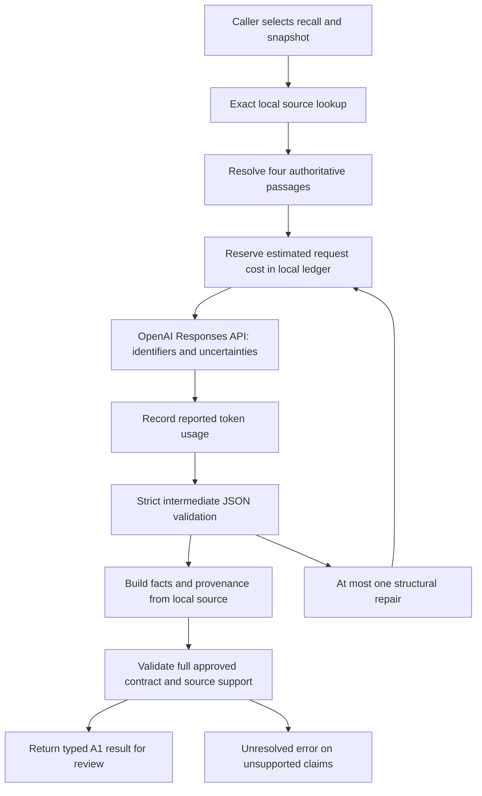

# RecallReady A1 implementation reference

Version: 1.0 — 18 November 2026. Audience: M1 integration, M2 implementation,
M3–M5 downstream interfaces, M6 requirements/UAT, and final-submission authors.
This is an implementation record, not a claim of production readiness or FDA
regulatory correctness. No presentation deck is included.

**Status note (19 November 2026):** This reference records the earlier A1
implementation stage. Its Group A+B counts, unrun Group B/Group C statements,
and suggested six-record report wording are historical. Use
`A1_18_RECORD_STATUS_2026-11-19.md` for current coverage and limitations.

## 1. Purpose and implementation status

RecallReady studies whether evidence-grounded interpretation can help humans
investigate historical food recalls. A1 structures recall evidence for later
agents. It must preserve exact identifiers and expose uncertainty.

| Capability | Status and evidence |
| --- | --- |
| Exact Group A+B lookup | Implemented in `source.py`; 12 original JSON records read inside the starter ZIP |
| Citation resolution | Implemented in `citations.py`; IDs, selection context and source text checked |
| Typed contract | Implemented in `models.py`; approved by M1 in the working conversation |
| Full source validation | Implemented in `validation.py`; shape, metadata, literals, labels, uncertainty and the approved limited ambiguous-lot gate |
| OpenAI interpretation adapter | Implemented in `interpreter.py`; Responses API, bounded structural repair, deterministic provenance |
| Local pilot accounting | SQLite usage ledger with persistent reservations and usage settlement |
| Human review in A1 | Explicit CLI review file, preflight provenance checks and local post-model application; see `A1_REVIEW_WORKFLOW_2026-11-19.md` |
| Review live verification | Two targeted reruns succeeded; see `A1_REVIEW_LIVE_RESULTS_2026-11-19.md` for human-assisted vs model-only outcomes |
| Real OpenAI inference | Six historical Group A runs; no paid Group B run yet. See `A1_GROUP_A_LIVE_REVIEW.md`, `A1_OPTION_A_POLICY_2026-11-19.md`, and `A1_GROUP_B_VERIFICATION_2026-11-19.md` |
| Qdrant retrieval / embeddings | NOT IMPLEMENTED in this increment |
| Authoritative-source SQLite migration | NOT IMPLEMENTED; the source is still read directly from ZIP |
| A2–A4, LangGraph, Streamlit, deployment | Outside this increment; no integration success claimed |

The SQLite ledger is cost accounting only. It is not the architecture's eventual
authoritative FDA evidence store or a replacement for CaseState.
CSV is approved for supplementary human review/export only; frozen JSON remains
the original source, and SQLite remains the planned exact store. No new CSV
export or source-store migration has been implemented.

## 2. Architecture authority and boundaries

The authority is `../project_reference/PROJECT_HANDOFF_MASTER.md`, based on the
reviewed v4.2 architecture. Runtime ownership remains A1/M2 → A2/M3 → A3/M5 →
A4/M4, coordinated by M1. M6 owns noncoding BA/UAT and presentation narrative.
The current implementation is a standalone A1 slice of that architecture.

A1 receives FDA evidence only. It does not read inventory, held-out labels,
FSSAI, cosmetics, or evaluation answers. It does not decide whether retailer
stock matches, declare products safe, or recommend disposal. Retrieved text
is untrusted data. Local provenance validation is required regardless of model.

The requested pilot uses GPT-6 Luna, low reasoning, Standard processing, with
a default local USD 1 accounting limit. These are pilot settings, not a team-wide
freeze of the model for every future agent. Alternative models need reviewed
pricing configuration; the adapter rejects an unpriced model rather than
silently applying Luna's rates.

## 3. Source identity and Group A+B coverage

Source archive: `../project_reference/RecallReady_Agent1_FDA_18_Starter.zip`.
It is read in place and preserved without extraction.

- Snapshot: `FDA-FOOD-2026-10-23-USER-SNAPSHOT`.
- ZIP SHA-256: `b1f55e7cc2b0ec37c29b87af31478230766b3ba9b45bd0db03c8c38c1bfe2f0e`.
- Starter contains 18 original food records, 18 distinct events, 72 passages.
- Current runtime allows the six Group A and six Group B recalls and their 48 passages.
- Four passage fields: product description, code information, recall reason,
  and distribution pattern.
- Derived convenience fields are not authoritative and are not sent to the model.

| Recall | Event | Source behavior to preserve |
| --- | --- | --- |
| H-0011-2027 | 99686 | Lot 26078, best-by wording, product/UPC context |
| F-1542-2023 | 92944 | Leading-zero lot 060723 and literal source UPC |
| F-1472-2024 | 94806 | Ambiguous date-like code phrase; no invented expiry meaning |
| H-0579-2025 | 97487 | Distinct lot, SKU and consecutive-count labels |
| F-0705-2025 | 96464 | Leading-zero lot; BC is not automatically a UPC assertion |
| F-0324-2023 | 91439 | Lot, spaced UPC, and sell-by wording |

These are development cases. The review examples are not independent approved
gold labels. No held-out accuracy estimate follows from testing these cases.

| Group B recall | Event | Source behavior to preserve |
| --- | --- | --- |
| F-0818-2023 | 92067 | UPC and lot remain separate exact identifiers |
| F-0882-2023 | 92215 | Batch `2-401` remains a batch |
| F-1025-2023 | 92421 | Batch `101097` and exact pasteurization reason |
| F-0011-2024 | 93135 | Lot, expiration and UPC labels remain distinct |
| F-0332-2023 | 91355 | Leading-zero lot, expiration and product UPC |
| H-1273-2026 | 99538 | Alphanumeric lot, literal `exp. date`, UPC and contamination reason |

Group B has offline source, citation, contract and mocked-transport adapter
coverage. It has not yet received paid model interpretation or human semantic
review, so it is not a measured model-accuracy result.

## 4. Modules and responsibilities

| File | Responsibility |
| --- | --- |
| `source.py` | Check packaged member hashes; enforce 12 Group A+B recalls/four fields each; resolve exact provenance; return source copies |
| `citations.py` | Compare immutable evidence; validate exact bounded literal occurrence in supporting product/code passages |
| `models.py` | Strict required fields, forbidden extras, string identifiers, paired evidence/point IDs |
| `validation.py` | Bind results to caller-selected context; verify metadata and citations; enforce conservative kind and scope rules |
| `interpreter.py` | Minimal model request, local envelope assembly, final validator, persistent usage accounting and CLI |
| `tests/test_task02a.py` | Six lookups, 24 passages, source preservation and rejection cases |
| `tests/test_task02b.py` | Contract, provenance, semantic guards, unknown/missing-source synthetic fixtures |
| `tests/test_interpreter.py` | Real SDK with fake HTTP transport; request construction, budget, repair and failure handling |
| `tests/test_group_b.py` | Six Group B lookups, 24 passages, exact literals, contract failures and six offline SDK flows |

Tests do not replace the source/citation validator. HTTP simulation verifies
integration behavior while avoiding paid calls; it cannot measure model quality.

## 5. Runtime flow and trust boundaries



The model never authors canonical metadata, snapshot/event IDs, point IDs or
original text in the final result. It proposes identifier values, kinds,
evidence references, and uncertainty descriptions. Scope notes are copied from
a cited canonical field. All references and values are validated after assembly.

Model input contains only four source passages plus trusted instructions and a
small intermediate schema. No reference examples, manual labels, credentials,
or inventory enter the prompt. `store=False` requests no response storage;
it does not establish zero retention or override provider policies.

## 6. Approved result contract

Read `TASK_02B_CONTRACT_PROPOSAL.md` for the detailed approved rules and
`task02b_contract.schema.json` for the exported structural schema.
The final envelope retains `contract_version: "0.1-proposed"` to preserve the
version literal reviewed by M1; this is not a pending approval indicator.

Envelope: `contract_version`, `snapshot_id`, `event_id`, `facts`, `source_fields`.
The eight facts fields remain recall number, product name, recalling firm,
recall reason, classification, identifiers, uncertainties and evidence IDs
(the exact key set is specified by the schema; identifiers is a nested array).
Earlier planning prose counted nine fields; the actual schema has always had
eight. This correction changes no contract keys.
Product name currently preserves the complete source product description.
Firm/classification come from canonical JSON and use null passage/point IDs.

Identifier kinds remain lot, batch, UPC, SKU, expiry date, use-by date, best-by
date, date range and other. Values must remain strings. `other` requires an
uncertainty. Scope notes preserve a whole cited source field. Unknown/no-code
text is not a literal identifier. Missing metadata becomes null with uncertainty;
missing original text for an existing passage is an integrity failure.

The literal checker does not prove meaning or completeness. The kind guard
requires explicit source labels and can reject valid unfamiliar wording.
Uncertainty wording and multi-product associations still require human review.
Structured lot/date/package associations remain deferred before Group C/A2.

## 7. Errors, retries and billing

SDK retries are disabled. A completed response with malformed JSON or incorrect
intermediate types may be regenerated once from the same evidence, with a
structural correction instruction. Generated model text is not forwarded as a
trusted instruction. Semantic/source validation failures do not trigger repair.
Refusal, incomplete output, transport error and missing usage stop the run.

Every request reserves an estimated charge first, including repairs. Reservations
use serialized request UTF-8 byte size plus a 4096-token overhead allowance and
the configured maximum output. Requests above the 20,000-token estimated input
allowance are blocked. Default maximum output is 4,000 tokens, including reasoning.
This estimate is deliberately conservative but is not a tokenizer or provider
guarantee. Actual reported usage replaces the estimate when available.

Rates configured on 2026-11-18: USD 0.10 per million input tokens and USD 0.50
per million output tokens. Cached input is conservatively counted at full input
price. Charges are rounded up to microdollars. These figures estimate API usage,
not invoices, taxes, credit eligibility or currency conversion.

Timeouts or missing usage retain the reservation because processing may have
occurred. Ledger entries contain response IDs, recall IDs, token counts and
estimated costs, not keys or prompts. `BEGIN IMMEDIATE` serializes concurrent
reservations using the same ledger file. Restarting with the same file retains
the budget history. A different/deleted ledger bypasses that local history.
The ledger is not a global billing control or durable hosted storage solution.
Use the provider's enforced project limit and disable auto-recharge separately.

## 8. Teammate setup and reproducibility

Use Python 3.11+; current verification environment is Python 3.13.6 on macOS.
Keep `code_workspace` beside `project_reference` or pass an explicit archive
path to `Source`. Direct dependencies are pinned in `requirements.txt`.

```bash
python3 -m venv .venv
.venv/bin/python -m pip install -r requirements.txt
.venv/bin/python -m pytest -q
```

The test suite requires no API key. SDK tests use an in-process HTTP transport;
no HTTP request leaves the process. Tests create explicitly synthetic ZIPs for
missing/unknown cases, without editing or extracting the authoritative archive.

Set `OPENAI_API_KEY` privately in your terminal environment or a secret manager.
The program does not load `.env` files automatically. Do not paste keys into chat,
commit keys, or expose a server-side key to browser code. The CLI explicitly uses
the official OpenAI endpoint. Existing account credits do not configure this key.

First paid pilot, when credentials are available:

```bash
.venv/bin/python interpreter.py --recall H-0011-2027 --allow-paid-call
```

Default ledger: `runtime/a1_usage.sqlite` (ignored by Git). Use the same ledger
for subsequent calls. The CLI prints the validated result or an unresolved
error, followed by usage accounting. Do not interpret an exit code 0 as human
approval of semantic correctness. A paid flag is required even if credits cover
the charge. Output and usage should be saved for a reviewed experiment; no paid
results are fabricated in this reference.

## 9. Team handoff and final-submission wording

M1: call the validator on the final payload before routing it downstream; do not
replace trusted selection context with model-supplied IDs. Integration with
CaseState is still pending. M2: review prompt, semantic outcomes and exact-source
lineage. M3: preserve uncertainties and never flatten independent identifiers
into implied combinations. M4: independently evaluate unsupported facts and
association correctness. M5: surface evidence and unresolved state in future UI.
M6: build acceptance/UAT cases from source behavior and record human judgments.

Suggested report wording:

> We implemented a bounded A1 prototype for six historical FDA development
> recalls. The prototype resolves exact local evidence and validates typed
> outputs, literal identifiers and citation provenance. A configurable OpenAI
> adapter proposes identifiers while deterministic code preserves source facts.
> Offline integration tests exercise simulated HTTP responses and failure paths.
> Six live development runs passed deterministic validation. Review found
> unresolved identifier boundaries and packaging uncertainty; independent
> extraction accuracy, retrieval effectiveness and full workflow performance
> remain unmeasured. See the dated live review for token and cost measurements.

Do not describe unit-test pass counts as extraction accuracy, successful Qdrant
RAG, or proof that the full four-agent app works. Do not invent contribution
percentages or author names. Cite actual team contributions at final submission.

For the live pilot record model ID, reasoning effort, prompt version/source
revision, snapshot/hash, recall IDs, timestamp, input/output/reasoning tokens,
cost estimate, validation outcome, latency, and human review findings. Then
expand from Group A to B/C under explicit scope review. Held-out evaluation
must remain independent and must not become runtime prompt material.

## 10. References and maintenance

- Local master handoff and reviewed v4.2 architecture in `project_reference`.
- Starter ZIP, including its manifest and original proposed facts schema.
- [OpenAI Responses quickstart](https://developers.openai.com/api/docs/quickstart).
- [GPT-6 Luna model and pricing](https://developers.openai.com/api/docs/models/gpt-6-luna).
- [Structured outputs](https://developers.openai.com/api/docs/guides/structured-outputs).

Keep this document with the code. When behavior changes, update the status table,
validation results and limitations together. Rerun the commands before citing
results in the final report. A dated verification record accompanies this file.
